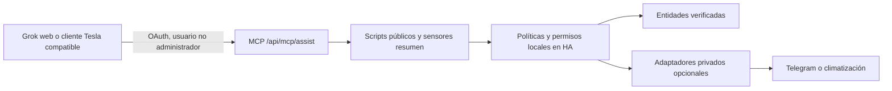

# Grok + Home Assistant: de la web al Tesla

Una base reutilizable para pedir a Grok informes de casa y ejecutar rutinas limitadas mediante **MCP Device control**. Home Assistant decide qué se puede hacer; Grok solo invoca scripts y consulta resúmenes.

Este repositorio nace con historial independiente y ejemplos ficticios. No contiene la configuración de una vivienda, credenciales, imágenes ni inventarios reales. Es una implementación de referencia para adaptar y validar, no una integración oficial de Tesla, Grok o Home Assistant.

## Qué incluye

| Función | Comportamiento |
|---|---|
| Preparar llegada | Comprueba presencia; puede encender una luz de entrada de noche con reserva temporal. Clima mediante adaptador opcional. |
| Revisar seguridad | Clasifica fuentes conocidas como OK, Advertencia, Crítico o Desconocido; muestra carencias y caducidad. |
| Salir de casa | Exige presencia familiar e interior verificadas; solo apaga las luces de una lista local. |
| Consultar homelab | Resume reglas de NAS, UPS, servidores, Docker o Zabbix que realmente hayas integrado. |
| Vacaciones y desactivación | Exige casa vacía, permite simular presencia con una lámpara dedicada y conserva los sistemas críticos. |
| Armado opcional | Dos órdenes: noche y fuera. Nunca desarma, introduce códigos ni fuerza contactos abiertos. |
| Fotos opcionales | Ejecuta un adaptador privado con cámara y destinatario Telegram fijos; una solicitud cada dos minutos. |

**De inicio no hay acciones físicas autorizadas.** Las secciones vacías se consideran sin cobertura. No se crean sensores ficticios para simular que tu instalación tiene dispositivos.

## Compatibilidad y límite de lo comprobado

- Base dirigida a Home Assistant **2026.11.2**. Consulta [validación](docs/validacion.md) para separar pruebas offline, validación real del motor y pruebas pendientes en cada casa.
- El conector personalizado se configura en la web de Grok. Tesla documenta Grok para vehículos con AMD y software 2025.26 o posterior; los conectores requieren 2026.26 o posterior, conexión y cuenta iniciada. **Eso no confirma por sí solo que tu coche ofrezca cada herramienta de un MCP personalizado.** Compruébalo con una consulta antes de habilitar acciones. [Tesla](https://www.tesla.com/support/grok), [conectores Grok](https://docs.x.ai/grok/connectors).
- No se ha certificado este paquete genérico de extremo a extremo en un Tesla. Si funciona en la web y el coche no ofrece el conector, la documentación no propone ningún bypass.



## Empieza por una consulta

1. Lee [instalación](docs/instalacion.md). Haz copia de tu configuración y comprueba que no existe ya el prefijo `tesla_grok_`.
2. Clona o descarga este repositorio. Dentro de su carpeta:

   ```bash
   python3 -m venv .venv
   .venv/bin/pip install -r requirements.txt
   mkdir -p local
   cp config.example.yaml local/config.yaml
   .venv/bin/python tools/generate.py --config local/config.yaml
   .venv/bin/python -m unittest discover -s tests -v
   ```

3. Configura entidades reales siguiendo [el mapa de configuración](docs/configuracion.md). El generador es offline: **no pide tokens ni se conecta a tu casa**. `local/` y `output/` están ignorados por Git.
4. Instala y valida el YAML generado como package. No copies `examples/adapters.yaml` sin adaptarlo: contiene referencias ficticias.
5. Conecta Grok con el endpoint de Device control y una cuenta no administradora; expón primero los dos scripts de consulta y sus sensores. Sigue [MCP y Tesla](docs/mcp-tesla.md).
6. Pide «Revisa la seguridad de casa y dime qué información falta». Después consulta el homelab. Que un informe diga «Desconocido» sin sensores es el resultado esperado.
7. Completa [las pruebas](docs/pruebas.md) antes de autorizar una acción física desde Home Assistant.

El generador no sobrescribe archivos existentes. Para otra versión utiliza `--output output/tesla_grok-v2.yaml`. No subas ese resultado a tu fork: contiene tus entidades.

## Documentación

- [Instalación, actualización y rollback](docs/instalacion.md)
- [Entidades, presencia, reglas y configuración](docs/configuracion.md)
- [Conector MCP, exposición y uso desde Tesla](docs/mcp-tesla.md)
- [Climatización, fotos, alarma y luces que son interruptores](docs/extensiones.md)
- [Frases y pruebas seguras](docs/pruebas.md)
- [Modelo de seguridad y límites](SECURITY.md)
- [Resultados de validación](docs/validacion.md)

No necesitas una integración Tesla para dar una orden de voz. Este proyecto tampoco usa la ubicación del coche como prueba de que la casa está vacía ni gestiona carga solar.

Licencia [MIT](LICENSE). Antes de compartir capturas, incidencias o un fork, elimina nombres, URLs, entidades personales, chats, localizaciones e historiales de tu configuración.
